# Tree-inator

Tree-inator turns drawn shapes into a top-down forest picture made of generated trees. A zone is drawn on a map and a forest grows inside it: trees of the chosen types, shrubs, grass, haze and cast shadows. The result is written at the size of the map as a PNG or another picture format.

This document covers building and running the tool, using the app, how each stage of the engine works, how tree types are generated and tuned, how themes are built, and the sources behind the methods.

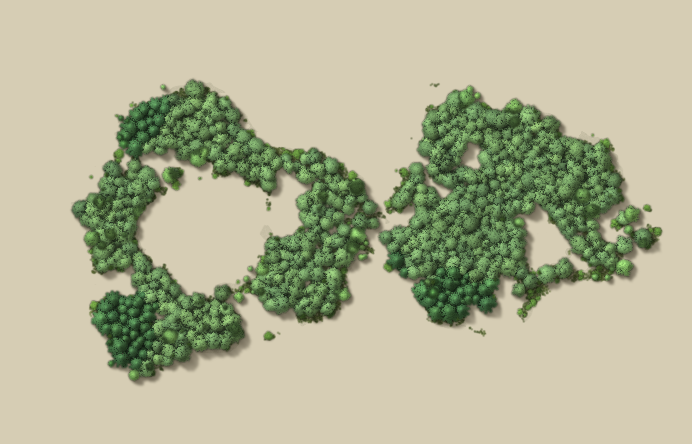

*A drawing of three zones (two forests and a clearing) rendered with the Eastern Hardwood theme.*

Contents

1. [Repository layout](#1-repository-layout)
2. [Build and run](#2-build-and-run)
3. [Using the app](#3-using-the-app)
4. [Project files](#4-project-files)
5. [How the picture is made, stage by stage](#5-how-the-picture-is-made-stage-by-stage)
6. [Tree types and the tree lab](#6-tree-types-and-the-tree-lab)
7. [Themes](#7-themes)
8. [Settings reference](#8-settings-reference)
9. [Tools folder](#9-tools-folder)
10. [References](#10-references)

---

## 1. Repository layout

```
crates/forest-core    the engine: everything that makes the picture
crates/tree-inator    the desktop app (egui), render worker thread, tuning panel
crates/forest-cli     command line renderer
tools/                small scripts for previewing tree types and themes, and for baking theme cards
```

Inside `forest-core/src`:

| File | Role |
| --- | --- |
| `engine.rs` | Plans the forest (distance map, cover, placement), stamps trees into a height map, shades every pixel. |
| `age.rs` | Stand age: growth curves and the largest crown of each tree type. |
| `treegen.rs`, `treegen_data.rs` | The parametric tree generator and its base presets. |
| `treegen_sprite.rs` | Draws generated trees from above into sprites; caches them. |
| `extra.rs`, `assets/extra_presets.json` | More tree types made from base presets, plus roots, logs and stumps. |
| `dead.rs` | Dead and burnt trees made by damaging living ones in stages. |
| `mushrooms.rs` | Baked mushroom sprites. |
| `shy.rs` | Crown shyness: squash factors that leave channels between crowns. |
| `smooth.rs` | Optional edge-preserving smoothing filter. |
| `field.rs`, `noise.rs`, `rng.rs` | Float rasters and blur, value noise and fractal noise, a small seeded random generator. |
| `geom.rs` | Zone geometry: boolean operations, offsets, outline tracing and simplification. |
| `groups.rs`, `stack.rs` | Groups of zones with their own settings, and the passes they are drawn in. |
| `compose.rs`, `render.rs` | Grading and stacking of layers, preview caching, strip-by-strip export in several formats. |
| `params.rs` | Every setting, the species list, the themes. |
| `gpu/` | Shading and compositing on the graphics card (`kernels.wgsl`, `stamp.wgsl`). |

Inside `crates/tree-inator/src`: `app.rs` (state and panels), `app/tuning.rs` (the settings registry and search), `app/tools.rs` and `app/zones.rs` (drawing tools and the zones panel), `app/compare.rs` (compare mode), `app/panel.rs` (theme cards), `worker.rs` (render and export thread).

---

## 2. Build and run

Requirements: a recent stable Rust toolchain on Windows with a graphics card that supports wgpu (Vulkan or DirectX 12). Without a usable card the engine renders on the processor. Python 3 with Pillow is needed only for the scripts in `tools/`.

```
cargo build --release
cargo run --release -p tree-inator
```

The app is `target/release/tree-inator.exe`. Windows will not replace a running exe, so the app must be closed before rebuilding.

### Command line renderer

```
forest-cli [project.treeproj] [options]
```

With no project a test shape is rendered.

| Option | Effect |
| --- | --- |
| `-out FILE` | Output file (default `out.png`). |
| `-scale S` | Render scale; 1.0 is one pixel per map pixel. |
| `-bg` | Tan background, for viewing. |
| `-theme NAME` | Apply a theme (case-insensitive name) after loading. |
| `-over FILE` | A JSON patch of the project, merged after the theme, so it wins over the theme's settings. |
| `-strips` | Render strip by strip, as the app exports, so memory stays bounded. |
| `-format png\|small\|tiles\|webp\|jpg` | Export format with `-strips`. |
| `-gpu`, `-gpushade` | Shade and composite on the graphics card; `-gpushade` stamps on the processor. |
| `-shy GAP` | Turn crown shyness on with a gap width. `-shygiants` limits it to giant mushrooms. |
| `-weave X`, `-smooth X` | Set canopy weave or smoothing. |
| `-chm FILE` | Write the canopy height map (16 bit, 1/256 render pixel per step). With `-out`, the picture is also rendered. |
| `-trees FILE` | Write the final tree list as JSON. |
| `-strokes FILE` | Replay brush strokes from a file. |
| `-layers` | Also write the layers on their own: `NAME_ground.png` (haze and grass), `NAME_underbrush.png` (shrubs and pebbles) and `NAME_canopy.png` (forest crowns and lone trees). The ground shadow stays in `-variants`' `_shadow` file. Transparent without `-bg`. |
| `-variants` | Write three files in one pass, like the app's Export section: `NAME.png` with shadows, `NAME_noshadow.png` and `NAME_shadow.png` (the ground shadow alone). Leave out `-bg` to keep them transparent. |
| `-save FILE` | Write the project as it stands after `-theme` and `-over`. Without `-out`, nothing is rendered. |

Examples (PowerShell, from the repository root):

```
# render a project with a theme, on the tan background
.\target\release\forest-cli.exe tools\sample_projects\demo_forest.json -theme "Aspen Stand" -bg -out aspen.png

# render at 2x, strip by strip, as a lossless WebP
.\target\release\forest-cli.exe tools\sample_projects\demo_forest.json -strips -scale 2 -format webp -out map.webp

# a JSON patch applied after the theme: write patch.json, then pass it with -over
'{"gen":{"age":80,"clump":0.5}}' | Set-Content patch.json
.\target\release\forest-cli.exe tools\sample_projects\demo_forest.json -theme "Eastern Hardwood" -over patch.json -bg -out aged.png

# save the project as it stands after the theme and patch (opens in the app)
.\target\release\forest-cli.exe tools\sample_projects\demo_forest.json -theme "Oak Savanna" -save demo_oak.json

# write the canopy height map and the tree list
.\target\release\forest-cli.exe tools\sample_projects\demo_forest.json -chm height.png -trees trees.json
```

The same commands in a POSIX shell use forward slashes and `./target/release/forest-cli`. `tools/sample_projects/demo_forest.json` is the project behind the pictures in this document. The Open button in the top bar loads it in the app.

### Environment variables

| Variable | Effect |
| --- | --- |
| `TREE_INATOR_EXTRAS` | Path to a copy of `extra_presets.json`. Tree types are read from it instead of the built-in table, and the sprite cache is bypassed. |
| `TREE_INATOR_CACHE` | Folder for the on-disk sprite cache, or `off`. The default is `%LOCALAPPDATA%\Tree-inator\sprites`. The cache is keyed to a hash of every source and asset file in `forest-core`, so any change to the generator or the presets starts a fresh cache after a rebuild. |
| `FOREST_TIMING` | Prints the time taken by each stage. |

---

## 3. Using the app

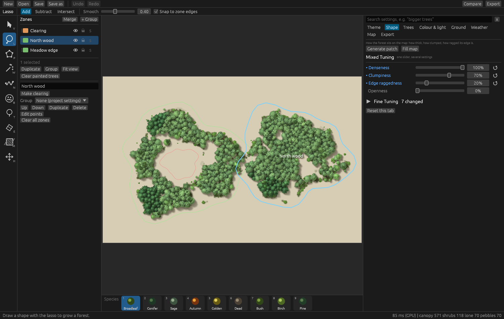

*The main window: tool strip, zones panel, map, tuning panel and species strip.*

### Drawing zones

The tool strip on the left holds the tools. Keys in brackets switch to them.

- **Select (V):** click a zone to select it, drag its corners or the zone itself, double click an edge to add a corner, right click a corner to remove it. Ctrl or Shift click adds to the selection. Delete removes the zone.
- **Lasso (L):** drag a loop. Jitter is removed and corners are rounded by the Smooth setting.
- **Polygon (P):** click corners; Enter or right click closes the shape; Escape cancels.
- **Wand (W):** click a region of an imported map picture and its outline is traced from colour. Tolerance sets how different a pixel may be from the one clicked; Contiguous limits the region to connected pixels.
- **Line (N):** draws a path. The path is cut as a clearing of a set width, laid with a row of trees at a set spacing, or used to split the selected zone in two.
- **Brush (B), Single tree (T), Eraser (E):** paint, place or remove individual trees. The keys `[` and `]` change the brush size.
- **No-trees mask (M):** a zone where no trees grow.
- **Pan (H):** moves the map. Middle drag or Space and drag also pan; the wheel zooms; F fits the map.

New shapes are made in one of three modes: Add makes forest, Subtract cuts a clearing, Intersect keeps only the overlap with existing zones. Holding Alt switches to Subtract; Shift and Alt together switch to Intersect. With Snap on, new points are pulled to nearby corners and edges of other zones. Ctrl+Z and Ctrl+Y undo and redo; R changes the random seed.

### Zones panel

Every zone and group is a row with an eye (show or hide), a lock (blocks edits) and a solo button (shows only that row). Rows are dragged onto a group to move them in, double clicked to rename, and right clicked for duplicate, copy and paste settings, make clearing and delete.

With zones selected: **Merge**, **Subtract** and **Intersect** combine them; **Smooth** and **Simplify** rework the outline; **Grow** and **Shrink** move it in or out by a set number of pixels; **Split with line** cuts a zone along a drawn path.

**Groups** hold zones and carry their own settings. Selecting a group puts the tuning panel in group mode: changes apply to the group's zones and to groups inside it that have not set the same setting themselves. A dot beside a setting marks it as changed in that group. Zones in no group follow the project settings.

A clearing cuts the group it is in and the groups inside it. A clearing in no group cuts everything. A no-trees mask cuts everything. Clearings and masks are applied after forests, whichever was drawn first.

### Species strip

The strip along the bottom lists every species in the project, each with a small picture of one tree of that type in the species' colours, and scrolls when there are more than fit. Keys 1 to 9 pick one of the first nine for the brush and for new forests. Letters in a corner mark the species used as main (M), mix (X) and shrub (S).

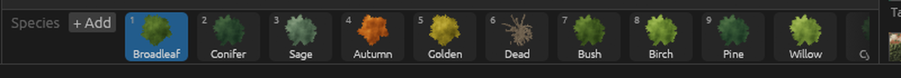

*The species strip: a sprite per species, role letters in the corners and the + Add button beside the label.*

- **+ Add** lists every tree type, including dead trees, logs and stumps, and adds a species with colours and height that suit the type.
- **Double-click** or right-click and **Edit** opens the species window: name, tree type, height, canopy fill, bark colour and the four leaf colours, with a button that resets colours and height to the type default.
- Right-click also offers **Duplicate** and **Use as main, mix or shrub species**.

### Tuning panel

Tabs on the right: Theme, Shape, Trees, Colour and light, Ground, Weather, Map and Export.

- The search box finds settings by name, by plain words (for example "bigger trees") and by close misspellings.
- **Mixed Tuning** holds a few intent sliders (Denseness, Clumpiness, Edge raggedness, Openness). Each moves several settings together.
- **Fine Tuning** holds every individual setting with a tooltip. Changed settings are marked and a reset arrow returns one to its default.
- **Compare** (top bar) splits the map: a snapshot on the left, the live forest on the right, so a set of changes can be judged and reverted.

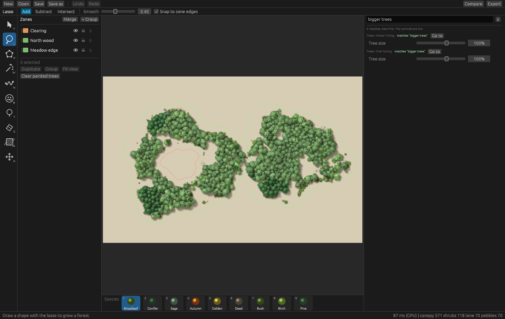

*Search finds settings from plain words: "bigger trees" lands on Tree size in both Mixed Tuning and Fine Tuning.*

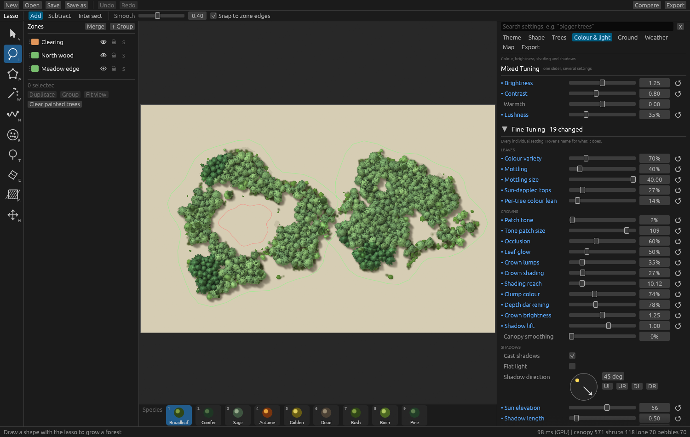

*Fine Tuning on the Colour and light tab, with every setting and a reset arrow for changed ones.*

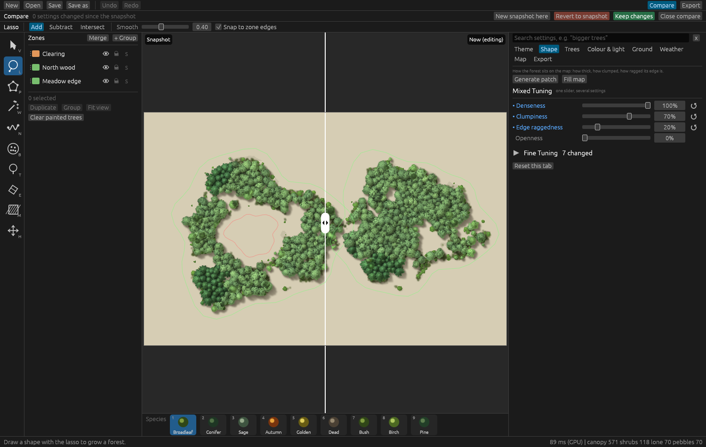

*Compare mode: the snapshot on the left, the live forest on the right, with buttons to take a new snapshot, revert or keep the changes.*

### Themes tab

Cards for each theme. Picking one sets species colours, ground and haze colours, and the structure that goes with it. Tree types picked by hand stay. The **Satellite Matched** section holds themes built from measurements of real forests (section 7).

### Map tab

An imported picture can sit under the forest as a reference. It is never exported. Options: opacity, position lock, scale bar, a 100 m grid, and a two-point calibration that sets how many map pixels make a metre. The map size is the pixel size of the picture the forest is placed on; exports use map pixels, so a PNG drops in at 0,0.

### Export

Export scale sets the output size (map size times scale). Variants: with shadows, without shadows (`_noshadow`), shadow only (`_shadow`), and the layers on their own (`_ground`, `_underbrush`, `_canopy`). Formats:

| Format | Notes |
| --- | --- |
| PNG | Quick to write; strips are written as they are made, so any size fits in memory. |
| PNG, smallest file | Best compression; slower to write. |
| PNG tiles | A folder of 1024 px tiles named `name_xC_yR.png` with a `name_tiles.json` index (columns, rows and each tile's position and size). Written strip by strip. |
| WebP, lossless | Usually under half the PNG size. The whole picture is held in memory, so maps above about 120 million pixels are refused. |
| JPEG | Quality 94, no transparency (blended over white). Same memory limit as WebP. |

---

## 4. Project files

Projects are JSON (`.treeproj`). Fields:

| Field | Content |
| --- | --- |
| `map_w`, `map_h` | Map size in pixels. |
| `shapes` | Zones: `op` (`Add` or `Subtract`), `points`, `name`, `visible`, `locked`, `mask`, `group`. |
| `groups` | Groups: `id`, `parent`, `name`, `visible`, `locked`, `collapsed`, `overrides` (a sparse settings object). |
| `gen` | Generation settings (section 8). |
| `light` | Shadow angle, sun elevation, shadow length and softness, shadows on or off, flat light. |
| `grading` | Per-layer and global hue, saturation, brightness, contrast, tint; shadow opacity and colour. |
| `species` | Tree species: name, tree type (`preset`), height, four leaf colours, bark colour, canopy fill. |
| `painted`, `erased` | Brush-placed trees and erased circles. |
| `background_image` | Reference picture path, opacity, scale, lock. |

Settings missing from a file take their defaults, and unknown settings are ignored, so older files open.

---

## 5. How the picture is made, stage by stage

### Overview

1. A distance map is made from the zones.
2. Cover and gaps are decided from the distance and from noise.
3. Trees are placed.
4. Each tree is drawn from a sprite of its type into a height map.
5. Shadows are worked out from the height map.
6. Each pixel is coloured.
7. Ground, haze and shadow layers are added, graded and stacked.

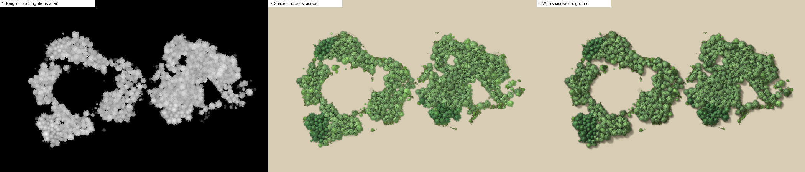

*Left to right: the height map every later stage works from, the shaded trees without cast shadows, and the final picture with shadows and ground.*

Placement and drawing into the height map run on the processor (`engine.rs`). Shading and compositing run on the graphics card when available (`gpu/`); the processor version is the reference and the fallback. All settings are defined in `params.rs`.

### Stage 1: the distance map and the edge

The zones are filled into a mask and a signed distance map is made from it: positive inside, negative outside, in map pixels. The distance drives the thinning of cover toward the edge and the pull-in.

The pull-in keeps the whole forest, fringe and stray trees included, inside the drawn line. It is a constant inset plus a steep depth ramp outside the envelope, and it varies along the outline. The Pull in setting scales it (100% fits exactly). With Contain on, a tree whose crown would cross the line is dropped, so the clip has nothing to cut; shadows are clipped too unless Keep shadows inside is off. Painted trees are exempt.

Edge patterns (fragmented, branching, clumps, lobed), warp and noise reshape the outline before any of this.

### Stage 2: cover and gaps

Cover is the share of ground crowns occupy. Where trees stand and where clearings fall is decided by layers of fractal noise (`noise.rs`, `field.rs`), so patches and holes are irregular. Settings: Coverage, Cover patch size, Edge thinning depth, Gaps, Gap size.

### Stage 3: placing trees

Trees are placed by dart throwing [4]: a random point is kept if it is allowed (cover says so) and not too close to a tree already kept. Closeness is measured in the sizes of the two crowns, so large trees keep more room. Crown radii are drawn between Smallest crown and Largest crown.

- **Stable placement.** Each dart draws all of its random numbers up front from a generator seeded by the layer and the dart's index, whether or not the dart lands. A tree's own seed (which picks its sprite variant and orientation) comes from where it stands. A change in one zone changes only the darts in that zone.
- **Tree clusters.** With Tree clusters above 0, parent points are spread over the map and the chance of keeping a dart is high near a parent and falls off with distance (a Thomas cluster process [5, 6]). Dart throwing fills every allowed place, so the chance is raised to a power that grows with the strength, which leaves real gaps between groves. Cluster size is the spread of one cluster.
- **Crown lean.** Each crown moves away from crowded neighbours toward open space: the push from every neighbour within 1.8 combined radii is summed, weighted by the neighbour's size, and applied up to 0.8 of the tree's own radius at full strength.
- **Crown shyness** (`shy.rs`). Crowns of similar height leave thin channels between them [7]. Each canopy tree gets a squash factor in 24 directions from its neighbours (crowns whose heights differ by more than 30% are left to overlap, and no crown is squashed below 55% of its size). The sprite is pulled in by that factor when stamped, so leaves keep their texture and the channel follows both outlines. Mushrooms are rigid. Gap width sets the channel.
- **Canopy weave.** The height of a crown is lifted toward its top so its edge starts high, with a per-pixel jitter. Crowns of similar height then interleave at their edges.
- **Other layers.** Shrubs grow where grass is and crowns are not. Lone trees appear in groups in the fringe band outside the forest (a Matérn cluster process [6]). Pebbles are small round bushes and stones near the edge. Mushrooms grow in clusters on open ground, and a share of the canopy can be giant mushrooms.
- A smaller tree is never placed inside a larger crown.
- Species are assigned after placement: the main species everywhere, then a second species in clumps chosen by noise (Mix amount, Mix clump size).

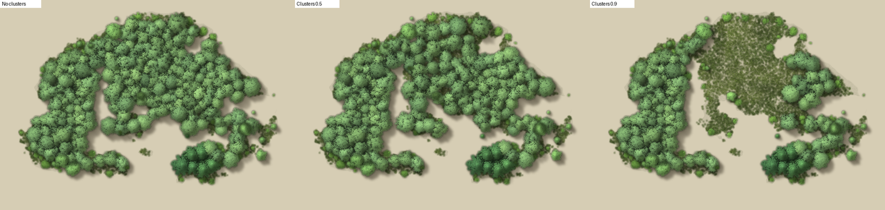

*Tree clusters at 0, 0.5 and 0.9 on the same zone. Higher values leave open ground between groves.*

### Stage 3b: stand age

Stand age in years scales the forest from young to old. 0 shows the forest as drawn, which stands for a mature stand. The age is worked into the settings before planning (`Project::aged` in `age.rs`).

- Crown size follows a growth curve [13] per tree type: `1 - exp(-2t/T)`, where T is the years the type needs to reach about 95% of its crown, divided by the same value at 60% of T. A crown is therefore the drawn size at maturity, smaller before, and slowly larger after, to about 1.4 times the drawn size.
- Every type has a largest crown, in metres, in `max_crown_radius_m` in `age.rs`. Crowns never exceed it, whatever the age or the crown settings. One generated map pixel stands for 0.45 m at forest size 100%.
- `years_to_grow` in `age.rs` sets T: 30 for pioneers (aspen, birch, willow, acacia, eucalyptus, bamboo, apple, cherry), 120 for oak, Douglas fir, bald cypress, baobab and banyan, 90 for most conifers, 60 otherwise.
- Young stands have lower cover, more shrubs and less variation in height. Old stands (past about 0.7 to 2.6 times T) gain gaps, wider gaps and a wider spread of heights.
- In a mixed stand each tree type is brought to its own stage from the main type's.

Adding a tree type to the ageing tables is two lines in `age.rs`.

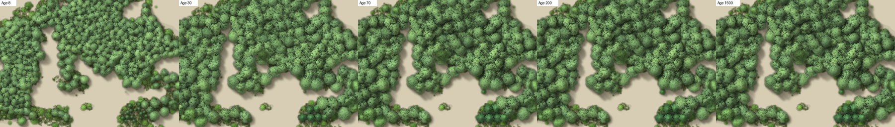

*Stand age 8, 30, 70, 200 and 1500 years on an Eastern Hardwood stand. Crowns grow, level off and stop at the largest size the tree type reaches.*

### Stage 4: sprites and the height map

Each tree is drawn from a sprite of its type (section 6). Sprites are resampled to the tree's crown radius and stamped into a height map, taller points winning. Each pixel keeps its height, tone, species, the direction its surface faces, how exposed it is, and whether it is leaf or wood. Painted trees are marked so they stay solid wherever placed.

### Stage 5: shadows

For each pixel the highest occluder along the ray toward the sun is found over the combined height map (a horizon search [9]), compared with the receiver's own height, softened near grazing rays and faded with distance, and then blurred by Shadow softness. Each layer receives its own shadow, which allows the shadow-only and no-shadow exports.

### Stage 6: colour and light

Each species has four leaf colours from dark to light. A pixel picks a place along that ramp from its exposure, tone, noise and the tree's own variation, and is multiplied by the light on it.

- **Light** combines the angle of the surface to the sun, how high the pixel stands compared with its surroundings (Crown shading), large soft tone patches (Patch tone) and a gamma and gain. A soft knee keeps the brightest leaves from washing out to white; colour past full brightness is scaled down, not clipped.
- **Colour variation:** Mottling (patches within a crown), Colour variety, Crown to crown difference, per-tree hue lean (Tree lean) and sun-dappled tops.
- **Occlusion** darkens crevices between and under crowns [10]. The height at a pixel is compared with blurred copies of the height map at 3 px, 9 px and crown scale; pixels lower than their surroundings darken. The setting raises the strength of those terms.
- **Leaf glow** adds a lighter leaf colour on pixels facing away from the sun that sit low in the crown (thin leaves), scaled by Leaf glow.
- **Crown lumps** tilts the surface normal [11] by the slope of the height map at a few pixels, so clumps inside a crown catch the light, not only the dome the sprite supplies.
- **Smoothing** is an optional Kuwahara filter [12]: each pixel takes the average of the least varying of four quadrants around it, which flattens crowns into lobes of one tone while keeping outlines crisp. Off by default.
- **Snow** clings to upward-facing, high surfaces and covers ground by distance from the edge, along a gradient or everywhere, with patchiness. **Fire** scorches and chars crowns, ashes the ground and can add flames and a glow.

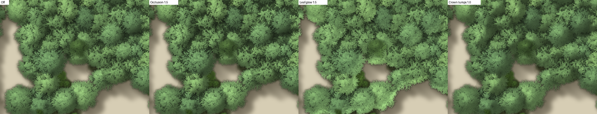

*The three optional shading terms on the same crowns: none, Occlusion, Leaf glow and Crown lumps.*

### Stage 7: ground, haze and layers

Grass is drawn from noise with accent patches and flecks in a second colour. Haze is a soft darkening around and under the forest. The layers in order are: haze, ground shadow, grass, shrubs, canopy, lone trees, pebbles. Each is graded separately (hue, saturation, brightness, contrast, tint) and a global grade applies on top. Blurred edge mode replaces the realistic edge with a feathered canopy floor.

Groups with their own settings are drawn as separate passes (`stack.rs`): zones in no group share the project settings and are drawn together; each group is drawn with the settings it ends up with and the passes are laid over each other. Neighbouring groups with identical settings and clearings are drawn together.

### Export

`render.rs` renders the map strip by strip (halos around each strip keep shadows and smoothing correct across seams) and hands each strip to a writer: streaming PNG, whole-picture WebP or JPEG, or tiles. Trees are planned once at a bounded grid size, so very large maps keep memory bounded.

---

## 6. Tree types and the tree lab

### How a tree is generated

Every tree is grown by a program that follows the Weber and Penn method [1]. A tree is a list of numbers per branching level: how many branches grow, how long they are, the angle they leave at, how much they curve and split. Levels run trunk, branches, twigs, leaves. The implementation in `treegen.rs` is a port to Rust of Charlie Hewitt's tree-gen [2, 3]; because the original is GPL-3.0, the combined work is GPL-3.0.

Several variants of every type are grown from different seeds and cached. `treegen_sprite.rs` draws the branches and leaves from above into a sprite: for every pixel, surface height, the direction the surface faces, tone, how exposed it is, and whether it is leaf or wood. Sprites are resampled to any crown size.

The raw generator makes sparse trees, fine for a close-up and too thin from above. Each type is therefore grown with a **canopy** setting that changes the generator itself, so every leaf still grows on a branch.

### The base presets

`treegen_data.rs` holds the base presets: `acer`, `apple`, `balsam_fir`, `bamboo`, `black_oak`, `black_tupelo`, `cambridge_oak`, `douglas_fir`, `european_larch`, `fan_palm`, `hill_cherry`, `lombardy_poplar`, `palm`, `quaking_aspen`, `sassafras`, `silver_birch`, `small_pine`, `sphere_tree`, `weeping_willow`, `weeping_willow_o`. Their canopy settings are in `canopy_for` in `treegen_sprite.rs`.

### Preset parameters

Scalars:

| Parameter | Meaning |
| --- | --- |
| `shape` | Envelope of the whole crown, used to scale branch length by height on the trunk: 0 conical, 1 spherical, 2 hemispherical, 3 cylindrical, 4 tapered cylindrical, 5 flame, 6 inverse conical, 7 tend flame, 8 envelope (set by the `prune_*` values). |
| `g_scale`, `g_scale_v` | Overall size of the tree in generator units, and its random variation. Leaf size and count are relative to it, so changing it changes how coarse or fine the foliage is at a given crown size. |
| `levels` | Number of branching levels (trunk counts as the first), up to 4. |
| `ratio` | Trunk radius relative to its length. `ratio_power` sets how radius falls with branch length at lower levels. |
| `flare` | Widening of the trunk base. |
| `base_splits` | Number of times the trunk forks near its base (negative gives a random number up to that many). |
| `leaf_blos_num` | Leaves (and blossoms) per twig. Negative values scale with the twig. |
| `leaf_shape` | 1 ovate, 2 linear, 3 cordate, 4 maple, 5 palmate, 6 spiky oak, 7 round oak, 8 elliptic, 9 rectangle, 10 triangle, 11 fan (ginkgo). |
| `leaf_scale`, `leaf_scale_x` | Leaf length relative to the tree, and width relative to length. |
| `leaf_bend` | How far leaves turn toward the light. |
| `blossom_shape`, `blossom_scale`, `blossom_rate` | The same for blossoms; rate is the share of leaves replaced by blossoms. |
| `prune_ratio`, `prune_width`, `prune_width_peak`, `prune_power_low`, `prune_power_high` | Pruning to an envelope: how strongly branches are cut back to it, its width, where it is widest, and how sharply it falls below and above that point. |
| `tropism` | Three numbers (x, y, z): growth bends toward this direction as it grows. Positive z bends up, negative z droops (willow uses -3); a sideways value makes wind-bent trees (krummholz). |

Arrays have four values, one per level (trunk, branches, twigs, leaves-carrying twigs):

| Parameter | Meaning |
| --- | --- |
| `branches` | Number of children per parent (the trunk's first value is 1). |
| `length`, `length_v` | Length as a fraction of the parent (the trunk's is of the tree) and its random variation. |
| `base_size` | Bare fraction of a stem before its first children grow. |
| `down_angle`, `down_angle_v` | Angle in degrees between a child and its parent: 0 along the parent, 90 at right angles. A negative variation makes the angle follow the position on the parent instead of being random. |
| `rotate`, `rotate_v` | Angle around the parent between successive children. Positive values spiral by that many degrees; negative values place children opposite one another. |
| `taper` | 0 a cylinder, 1 a cone, 2 a rounded end; above 2 gives bulges along the stem. |
| `curve_res` | Segments per stem. More segments give smoother bends and more places to split or curve. |
| `curve`, `curve_back`, `curve_v` | Total bend in degrees (negative droops), a second bend for an S shape, and random variation. A negative `curve_v` makes a helix. |
| `bend_v` | Random bend of the whole branch. |
| `seg_splits` | Forks per segment (0 none, 1 every segment). `split_angle`, `split_angle_v` set the angle and its variation. |
| `branch_dist` | Spread of children along the parent. |
| `radius_mod` | Radius multiplier per level. |

### Canopy parameters

Used for every type, in `extra_presets.json` as `canopy` and in `canopy_for` for the base presets. All multiply or add to the generator's own values:

| Parameter | Meaning |
| --- | --- |
| `leaves` | Leaves (and blossoms) per twig. |
| `twigs` | Leaf-bearing twigs per branch. |
| `twig_len` | Twig length. |
| `leaf_size`, `leaf_width` | Leaf size, and width (capped at as wide as long). |
| `blossom_size` | Blossom size. |
| `wood` | Thickness of trunk and branches. Lower values hide the wood. |
| `limbs` | Number of main limbs the trunk grows. |
| `limb_base` | Bare stretch at the base of each limb before it branches. |
| `limb_rise` | Degrees the main limbs curve upward along their length: a dome instead of a bowl. |
| `inner` | Leaves along the branches below the twigs and the trunk above its base, as a share of a twig's leaf count. |
| `sky` | How far each leaf turns its face up to the sky, 0 to 1. |
| `light` | How strongly late branches bend toward open sky while they grow, 0 to 1, so the crown fills its own gaps. Types that go lopsided with it get less. |
| `rise` | Degrees the twigs curve upward, so foliage rides on top of the limbs. |

The defaults for a type in the extra table are `leaves 2.0, twigs 1.5, twig_len 1.1, leaf_size 1.3, inner 0.4, sky 0.7, light 0.5`.

### Adding a new tree type

1. **Choose a base preset** from the list above, the one closest in structure.
2. **Add an entry** to `crates/forest-core/assets/extra_presets.json`:

```json
"my_tree": {
  "base": "black_oak",
  "preset": { "g_scale": 12.0, "branches": [1, 20, 80, 0], "length": [1, 0.5, 0.3, 0.2], "tropism": [0, 0, 0.3] },
  "canopy": { "leaves": 2.0, "twigs": 1.5, "inner": 0.5, "light": 0.5 }
}
```

   `preset` changes only the listed fields. For an array, listed values replace the first values of the base's array and the rest are kept. `canopy` changes only the listed values of the default canopy above. Optional fields: `"kind": "log"` or `"stump"` for the two direct builders; `"roots": {"count": 14, "reach": 1.55, "from": 0.35, "thick": 0.8}` for stilt roots (count, reach in crown radii, height on the trunk where they leave as a share of the trunk's height, thickness as a share of the trunk's radius); `"crown_scale"` to shrink the crown inside its sprite to leave room for roots. `"hide_wood": true` draws the branches as the darkest foliage so no bare wood shows between needle masses; the base fir, pine and larch types do this too.
3. **Preview it** without rebuilding: copy the file, edit the copy, and run

```
python tools/lab_sheet.py sheet.png copy.json my_tree:5f7f5a:1.0
```

   which renders two single trees and a small forest of the type. The argument is `name:leafcolour:height`. The copy is read through `TREE_INATOR_EXTRAS` (the environment variable can also be set for the app and `forest-cli`). `canopy_lab` (`cargo run --release -p forest-core --example canopy_lab`) tries canopy settings on one preset and prints how much of each crown is gaps and wood.
4. **Register the name** in the `TREE_TYPES` list in `crates/forest-core/src/treegen_sprite.rs` as `("my_tree", "Label in the picker")`, so the app's pickers list it.
5. **Optionally add ageing data** in `age.rs`: its largest crown radius in metres and its years to grow. Types not listed use 8 m and 60 years.
6. **Rebuild.** The type is then available as a tree type for any species, in the species strip, in themes and in the brush.

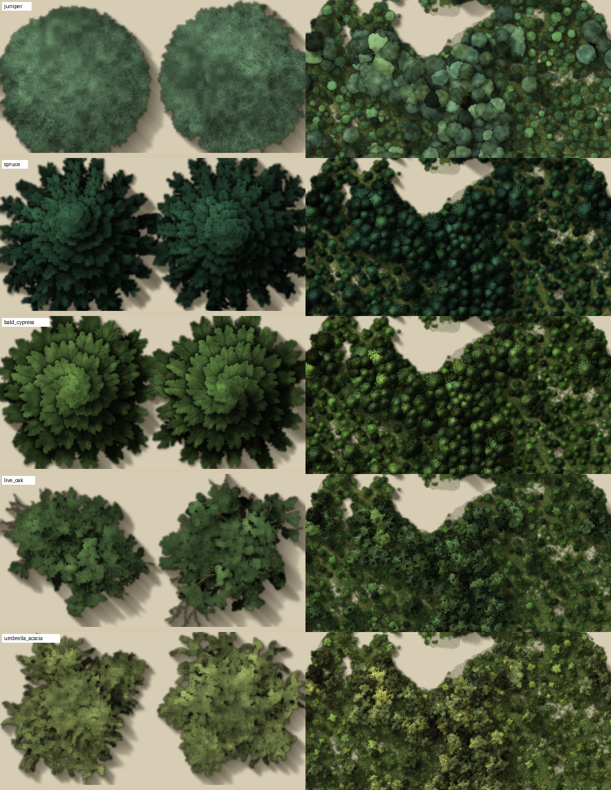

*Output of `tools/lab_sheet.py`: two single trees and a small forest for each new tree type (juniper, spired spruce, bald cypress, live oak, umbrella acacia).*

### Tuning the numbers

- Wider crown: raise `down_angle[1]` toward 90 and `length[1]`.
- Taller, narrower crown: lower `down_angle[1]`, raise `g_scale`, use `shape` 0 or 5.
- Denser foliage from above: raise canopy `leaves`, `twigs` and `leaf_size` before touching `leaf_blos_num`.
- Hide wood: lower canopy `wood`, raise `inner`.
- Drooping branches: negative `curve`, negative `tropism` z.
- Open, spiky outline: lower `branches[1]` and `branches[2]`, raise `length_v`.
- Lopsided crown that leaves gaps: lower canopy `light`.
- Foliage riding over bare limbs: raise canopy `rise` and `limb_rise`.

Dead trees (`dead.rs`) are living trees whose geometry is damaged in stages that follow the five snag decay classes [8]: fine twigs go first, then small branches, then larger limbs snap and leave stubs, then the top breaks off. A stag-headed tree has a bare outer and upper crown over a green inner crown. Burnt types char the wood and leave less of it. Standing dead wood is silver-grey and sparse, with dark ground showing through. Logs are long, thin, nearly straight and pale; stumps are a plain cut face with faint rings, a dark rim and short root stubs.

---

## 7. Themes

A theme is a set of species colours, a ground colour, a haze colour and optional structure settings.

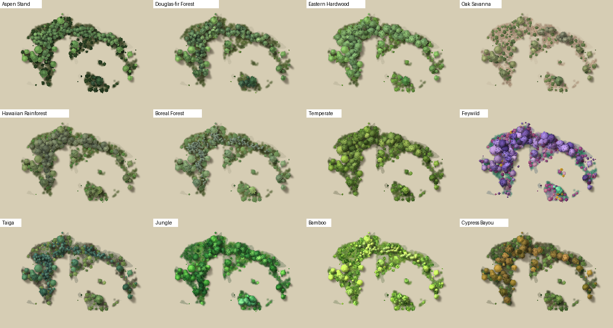

*Output of `tools/all_themes_sheet.py`: six satellite matched themes (top rows) and plain themes on the same forest.* Picking a theme (`Project::apply_theme` in `params.rs`) adds its species, selects them for the main, mix and shrub slots, and sets the colours. A slot that was a hand-picked tree type keeps its type and takes the theme's colours.

### Plain themes

Defined in `base_themes()` in `params.rs`: a name, a note, three species (colour ramp, tree type, height), a mix amount, and ground, accent and haze colours. Each also takes a share of the structure of a measured forest according to `assets/natural_looks.json`:

```json
"Feywild": { "from": "Eastern Hardwood", "strength": 0.5, "layout": 0.6, "tone": 0.6, "sat": 0.95, "val": 1.0, "crown": 1.1 }
```

| Field | Effect |
| --- | --- |
| `from` | The satellite matched theme it borrows from. |
| `strength` | Share (0 to 1) of that stand's look taken: crown variation, shading, weave, occlusion, glow, lumps, leaf styling. |
| `layout` | Share of its layout taken: gaps, gap size, cover patch size, shrub and grass density, crown lean, crown sizes. |
| `tone` | Share of its lightness and hue steps laid over the theme's own colours, so any palette varies the way real canopy does. Value is moved toward the stand's, saturation is capped, hue shifts between dark and lit leaves. |
| `sat`, `val` | Muting and darkening of the theme's colours. |
| `crown` | Crown size relative to the stand's. |

A theme without an entry uses `default`. `theme_canopy` in `params.rs` sets the cover for themes made of bare or sparse trees.

### Satellite matched themes

Built from measurements of real forests and stored in `assets/satellite_themes.json`, one entry per theme:

```json
"Aspen Stand": { "note": "...", "order": 0, "mix_amount": 0.12,
  "species": [ { "name": "...", "preset": "quaking_aspen", "height": 1.0, "ramp": [[r,g,b] x 4], "bark": [r,g,b] }, ... three species ],
  "grass": [r,g,b], "accent": [r,g,b], "haze": [r,g,b],
  "gen": { "crown_max": 9.8, "crown_min": 5.9, "canopy_cover": 0.69, "gaps": 0.2, "depth": { ... }, "leaf": { ... } } }
```

`order` sets the position in the Satellite Matched section. `gen` is merged into the project's generation settings when the theme is picked.

How a stand is measured:

1. A stand of the forest type is chosen.
2. Aerial lidar gives canopy height at 1 m. From it come crown size, cover, gap size and frequency, and height variation.
3. Where available, hyperspectral reflectance gives true colour without a camera's tone curve or haze. The scene is separated into sunlit crown, shaded crown, sunlit ground and shaded ground [14], using the lidar and the sun angle from the flight record, so shadow is never mistaken for foliage.
4. An automatic search changes the engine's settings until its render, measured in the same way, matches the stand.

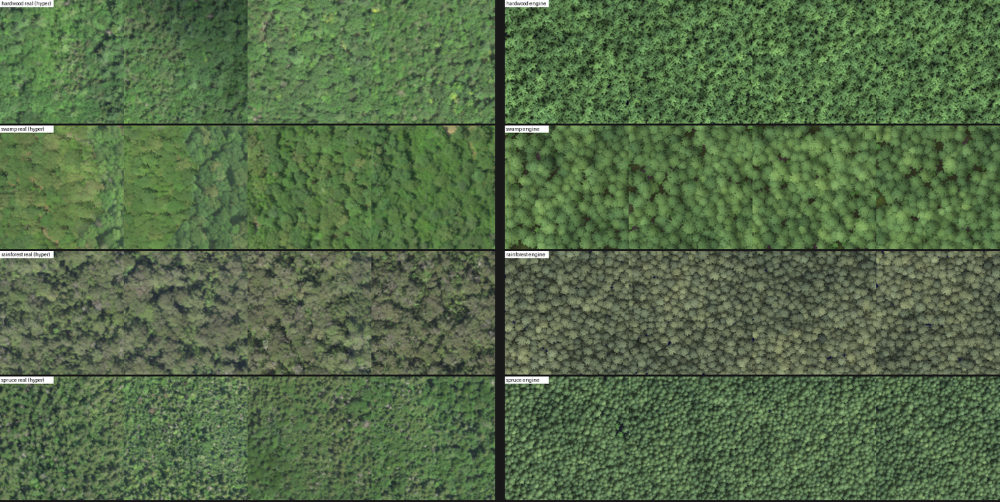

*Real hyperspectral imagery (left four) beside renders of the matched settings (right four), for eastern hardwood, bottomland swamp, tropical rainforest and spruce-fir stands.*

Rules that hold for every theme:

- A theme never changes the forest size setting. The theme's own crown sizes carry the proportions, so trees are in scale with each other and the forest size slider stays free for creative use. The scale is 0.45 m per map pixel: the default medium crown, about 13.5 px in radius, stands for a broadleaf tree of about 6 m crown radius.
- One exposure is used for the hyperspectral colour of every stand, and the brightest few percent of leaf pixels are left out of each palette, because camera exposure and glare from wet leaves distort brightness.
- Where a stand shows no bare ground, the ground colour is the standard grass colour (70, 86, 40).
- Smoothing is not used.

Data used: NEON aerial lidar, camera mosaics and hyperspectral reflectance across the USA [15, 16, 17]; NASA G-LiHT lidar and photos of the El Yunque rainforest, Puerto Rico [18]; aerial photos of Japanese bamboo groves from the Geospatial Information Authority of Japan [19], where no lidar or hyperspectral data is available, so that theme is matched from photos alone; LANDFIRE land cover, for choosing tiles [20].

### Adding a theme

1. For a plain theme, add a `Theme { ... }` to `base_themes()` and, optionally, an entry in `natural_looks.json`. For a satellite matched theme, add an entry to `satellite_themes.json`.
2. Bake its card picture and regenerate the card list:

```
python tools/bake_theme_cards.py          # new themes only
FORCE=1 python tools/bake_theme_cards.py  # all themes (set the variable in the shell's own syntax)
```

   This renders each theme on a standard layout with `forest-cli`, writes `crates/tree-inator/assets/themes/<slug>.png` and regenerates `crates/tree-inator/src/app/theme_cards.rs`. `forest-cli` must be built first.
3. Rebuild.

---

## 8. Settings reference

Settings live in `gen` in the project file and are listed in `crates/tree-inator/src/app/tuning.rs`, one row each (`path`, label, tab, group, kind, range, tooltip, search aliases). A new setting needs a field in `GenParams` (`params.rs`) with a default, a row in `tuning.rs`, and use in the engine. Shading settings used on the graphics card also need an entry in the parameter list in `gpu/mod.rs` and use in `gpu/kernels.wgsl`.

| Area | Settings (path in `gen`) |
| --- | --- |
| Shape | `contain`, `contain_fit`, `contain_clip`, `contain_shadows`, `edge_mode`, `feather`, `shape_softness`, `edge_warp`, `edge_noise`, `pattern`, `pattern_strength` |
| Size | `scale` (forest size), `crown_min`, `crown_max`, `age` (stand age in years) |
| Density | `canopy_cover`, `canopy_patch_size`, `canopy_edge_depth`, `gaps`, `gap_size`, `clump`, `clump_size`, `shrub_density`, `lone_groups`, `lone_reach`, `interior_lone`, `pebbles` |
| Crowns | `crown_lean`, `crown_shyness`, `shyness_gap`, `shyness_giants_only`, `depth.weave`, `depth.smooth` |
| Species | `main_species`, `mix_species`, `shrub_species`, `mix_amount`, `mix_scale` |
| Colour and light | `leaf.variety`, `leaf.mottling`, `leaf.mottle_size`, `leaf.dappled`, `leaf.tree_lean`, `depth.crown_tone`, `depth.crown_tone_size`, `depth.crown_shade`, `depth.shade_radius`, `depth.height_var`, `depth.cluster_tone`, `depth.depth_strength`, `depth.gamma`, `depth.gain`, `depth.crown_var`, `depth.canopy_ao`, `depth.translucency`, `depth.lumps` |
| Ground | `grass_density`, `grass_reach`, `grass_color`, `grass_accent`, `haze_opacity`, `haze_reach`, `haze_color` |
| Weather | `snow.*`, `fire.*` |
| Mushrooms | `mushrooms`, `mushroom_mix`, `giant_mushrooms` |
| Light (`light`) | `shadow_angle`, `elevation`, `shadow_length`, `shadow_softness`, `shadows`, `flat` |

---

## 9. Tools folder

Small Python scripts (Python 3 with Pillow). All expect a built `target/release/forest-cli.exe`.

| Script | Use |
| --- | --- |
| `lab_sheet.py OUT.png TABLE.json name:RRGGBB[:height] ...` | Single trees and a forest of each type from a tree table, for tuning tree types. `-` as the table uses the built-in one. |
| `all_themes_sheet.py OUT.png [project] [scale] [theme ...]` | Every theme (or the named ones) on the same forest in one labelled sheet. |
| `variants_sheet.py OUT.png THEME SCALE 'label={json patch}' ...` | The same forest with different settings side by side. With `AFTER=1` the patches are applied after the theme. `BASE` picks the project and `CROP` (as fractions `x0,y0,x1,y1`) crops. |
| `bake_theme_cards.py` | Bakes the theme card pictures (section 7). |

`tools/sample_projects/` holds small projects for these scripts.

### Examples

Each command produced one of the pictures above. PowerShell needs the double quotes inside JSON escaped with a backslash; a POSIX shell takes the same text in plain single quotes without the backslashes.

```
# tree lab: single trees and a forest for each type
python tools\lab_sheet.py docs\images\tree_lab.png - juniper:5f7f5a:0.9 spruce:2f5238:1.4 bald_cypress:5a7a3a:1.3 live_oak:4f6b3a:1.0 umbrella_acacia:7f8a4a:0.8

# try an edited copy of the tree table instead of the built-in one
copy crates\forest-core\assets\extra_presets.json my_trees.json
python tools\lab_sheet.py sheet.png my_trees.json my_tree:5f7f5a:1.0

# theme gallery: the named themes on one forest, 0.45 scale
python tools\all_themes_sheet.py docs\images\themes_sheet.png tools\sample_projects\sheet_project.json 0.45 "Aspen Stand" "Oak Savanna" Temperate Feywild

# every theme (no names given)
python tools\all_themes_sheet.py all_themes.png tools\sample_projects\sheet_project.json 0.3

# stand age, one render per value, applied after the theme (AFTER=1), cropped to the middle (CROP)
$env:BASE='tools\sample_projects\blob_project.json'; $env:AFTER='1'; $env:CROP='0.2,0.2,0.8,0.8'
python tools\variants_sheet.py docs\images\stand_age.png "Eastern Hardwood" 1.2 'Age 8={\"gen\":{\"age\":8}}' 'Age 70={\"gen\":{\"age\":70}}' 'Age 1500={\"gen\":{\"age\":1500}}'

# shading terms compared on the same crowns
$env:CROP='0.35,0.35,0.6,0.62'
python tools\variants_sheet.py docs\images\shading.png "Eastern Hardwood" 3 'Off={\"gen\":{\"canopy_cover\":1.0}}' 'Occlusion={\"gen\":{\"canopy_cover\":1.0,\"depth\":{\"canopy_ao\":1.5}}}'

# theme cards: new themes only, then all of them
python tools\bake_theme_cards.py
$env:FORCE='1'; python tools\bake_theme_cards.py
```

`variants_sheet.py` merges each patch into the base project before the theme unless `AFTER=1` is set; a patch to `crown_min`, `crown_max` or other settings a theme also sets needs `AFTER=1` to take effect. The base project is `BASE` (default `tools/sample_projects/sheet_project.json`).


---

## 10. References

Each source below contains the method or data named after it.

**Tree generation**

1. Weber, J. and Penn, J. (1995). Creation and rendering of realistic trees. *Proceedings of SIGGRAPH '95*, 119 to 128. https://doi.org/10.1145/218380.218427 (PDF: https://courses.cs.duke.edu/fall02/cps124/resources/p119-weber.pdf). Used for the parametric branching model: the per-level parameter arrays, crown shape envelopes, pruning and tropism.
2. Hewitt, C. (2017). *Procedural generation of tree models for use in computer graphics*. Computer Science Tripos Part II dissertation, University of Cambridge. https://chewitt.me/Papers/CTH-Dissertation-2017.pdf. Used for the description of the Weber and Penn implementation that `treegen.rs` follows.
3. Hewitt, C. tree-gen (code, GPL-3.0). https://github.com/friggog/tree-gen. The generator and base presets that `treegen.rs` and `treegen_data.rs` port.

**Placement**

4. Cook, R. L. (1986). Stochastic sampling in computer graphics. *ACM Transactions on Graphics* 5(1), 51 to 72. https://doi.org/10.1145/7529.8927. Used for dart throwing: keep a random point only if it is a minimum distance from the points already kept.
5. Thomas, M. (1949). A generalization of Poisson's binomial limit for use in ecology. *Biometrika* 36(1 to 2), 18 to 25. https://doi.org/10.1093/biomet/36.1-2.18. Used for the cluster process behind Tree clusters: parents spread at random with offspring scattered around them.
6. Illian, J., Penttinen, A., Stoyan, H. and Stoyan, D. (2008). *Statistical Analysis and Modelling of Spatial Point Patterns*. Wiley. https://doi.org/10.1002/9780470725160. Used for the Thomas and Matérn cluster processes (Tree clusters, lone tree groups).
7. Putz, F. E., Parker, G. G. and Archibald, R. M. (1984). Mechanical abrasion and intercrown spacing. *American Midland Naturalist* 112(1), 24 to 28. https://doi.org/10.2307/2425452. Used for the crown shyness phenomenon: empty channels between neighbouring crowns of similar height.
8. Cline, S. P., Berg, A. B. and Wight, H. M. (1980). Snag characteristics and dynamics in Douglas-fir forests, western Oregon. *Journal of Wildlife Management* 44(4), 773 to 786. https://doi.org/10.2307/3808305. Used for the five decay classes of standing dead trees that dead tree stages follow.

**Shading and filtering**

9. Max, N. L. (1988). Horizon mapping: shadows for bump-mapped surfaces. *The Visual Computer* 4(2), 109 to 117. https://doi.org/10.1007/BF01905562. Used for shadows from a height field by finding the highest occluder toward the light.
10. Luft, T., Colditz, C. and Deussen, O. (2006). Image enhancement by unsharp masking the depth buffer. *ACM Transactions on Graphics* 25(3), 1206 to 1213. https://doi.org/10.1145/1141911.1142016. Used for darkening by the difference between a height or depth map and a blurred copy of it (Occlusion).
11. Blinn, J. F. (1978). Simulation of wrinkled surfaces. *Computer Graphics (SIGGRAPH '78)* 12(3), 286 to 292. https://doi.org/10.1145/965139.507101. Used for perturbing the surface normal by the slope of a height field (Crown lumps).
12. Papari, G., Petkov, N. and Campisi, P. (2007). Artistic edge and corner enhancing smoothing. *IEEE Transactions on Image Processing* 16(10), 2449 to 2462. https://doi.org/10.1109/TIP.2007.903912. Used for the Kuwahara filter and its generalisation (Smoothing).

**Growth**

13. Richards, F. J. (1959). A flexible growth function for empirical use. *Journal of Experimental Botany* 10(2), 290 to 301. https://doi.org/10.1093/jxb/10.2.290. Used for the family of growth curves that includes the monomolecular curve behind Stand age.

**Measuring real stands**

14. Li, X. and Strahler, A. H. (1985). Geometric-optical modeling of a conifer forest canopy. *IEEE Transactions on Geoscience and Remote Sensing* GE-23(5), 705 to 721. https://doi.org/10.1109/TGRS.1985.289389. Used for the scene as four components: sunlit crown, shaded crown, sunlit ground and shaded ground.

**Data**

15. NEON. Spectrometer orthorectified surface directional reflectance, mosaic (DP3.30006.001). https://data.neonscience.org/data-products/DP3.30006.001. Hyperspectral colour of the older flights.
16. NEON. Spectrometer orthorectified surface bidirectional reflectance, mosaic (DP3.30006.002). https://data.neonscience.org/data-products/DP3.30006.002. Hyperspectral colour of flights from 2022 on.
17. NEON. Ecosystem structure, canopy height model (DP3.30015.001). https://data.neonscience.org/data-products/DP3.30015.001. Canopy height at 1 m. NEON program: https://www.neonscience.org/.
18. NASA G-LiHT canopy height model V001. https://lpdaac.usgs.gov/products/glchmtv001/, and aerial orthomosaic V001. https://lpdaac.usgs.gov/products/glorthov001/. Lidar heights and photos of El Yunque, Puerto Rico. Project: https://gliht.gsfc.nasa.gov/.
19. Geospatial Information Authority of Japan, seamless aerial photo tiles (`https://cyberjapandata.gsi.go.jp/xyz/seamlessphoto/{z}/{x}/{y}.jpg`, zoom 14 to 18; credit "Geospatial Information Authority of Japan tiles"). Terms and tile list: https://maps.gsi.go.jp/development/ichiran.html. Photos of the bamboo groves.
20. LANDFIRE. https://landfire.gov/. Land cover used to choose which tile of a forest type to study.
